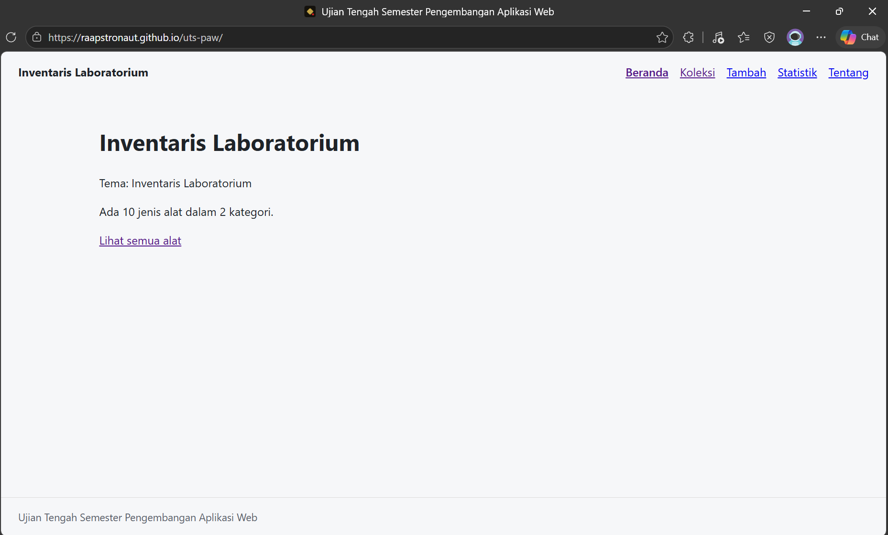

# Ujian Tengah Semester

**Nama:** Muhamad Rafi Ilham  
**NIM:** 123140173  
**Kelas:** PAW RB  
**Tema:** Inventaris Laboratorium  
**URL Deployment:** https://raapstronaut.github.io/uts-paw/



## Fitur
- Menampilkan daftar barang inventaris laboratorium
- Mencari barang berdasarkan nama
- Melihat informasi detail barang
- Menambahkan barang baru
- Menghapus barang dari daftar inventaris
- Menampilkan statistik jumlah barang per kategori
- Memfilter barang berdasarkan kategori
- Menyimpan data menggunakan localStorage

## Menjalankan secara lokal
```
cd app
npm install
npm run dev
```